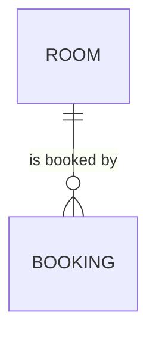

# Entity Model

## Entity Relationship Diagram

### ROOM

A meeting room of the office that employees can book.

| Attribute | Description                              | Data Type | Length/Precision | Validation Rules       |
|-----------|------------------------------------------|-----------|------------------|------------------------|
| id        | Unique identifier                        | Long      | 19               | Primary Key, Sequence  |
| name      | Name of the room as shown at the door    | String    | 50               | Not Null, Unique       |
| capacity  | Number of people the room seats          | Integer   | 10               | Not Null, Min: 1, Max: 50 |
| equipment | Free text: projector, whiteboard, and so on | String | 200              | Optional               |

**Constraints:** The name is unique compared case-insensitively and stored without leading or trailing spaces
(FR-002, UC-001 BR-001, UC-001 BR-002).

### BOOKING

A time slot for which an employee has booked a room.

| Attribute | Description                       | Data Type | Length/Precision | Validation Rules              |
|-----------|-----------------------------------|-----------|------------------|-------------------------------|
| id        | Unique identifier                 | Long      | 19               | Primary Key, Sequence         |
| room_id   | The booked room                   | Long      | 19               | Not Null, Foreign Key (ROOM.id) |
| booked_by | Name of the employee who booked   | String    | 100              | Not Null                      |
| starts_at | Start of the time slot            | DateTime  | -                | Not Null                      |
| ends_at   | End of the time slot              | DateTime  | -                | Not Null                      |
| purpose   | What the meeting is about         | String    | 200              | Optional                      |

**Constraints:** A booking ends after it starts (UC-002 BR-001). Two bookings of the same room never overlap
(FR-005, UC-002 BR-002).
